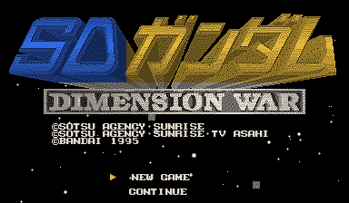
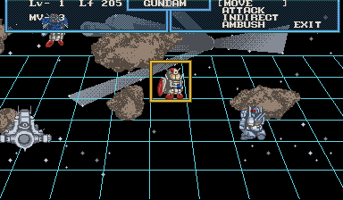
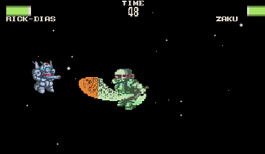
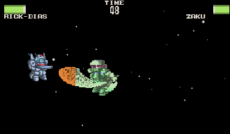
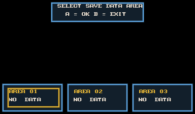
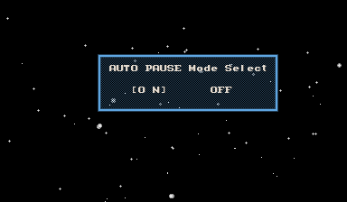
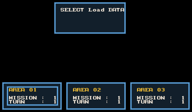
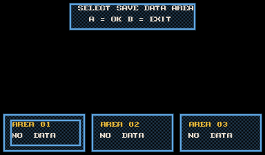

# Gundam reference color mod

Version **0.2.2** extends the optional color mod to all **47 cartridge units**:
five tactical layouts and both battle sheets, including later-roster mobile
suits, mobile armors and warships. Shared masks cover Japanese/Latin text,
menus, HUD, terrain, rifle fire, impacts, thrusters and explosions. The accepted
booklet-inspired title and detailed opening masks remain in place.

Color changes hue after native rendering. Original shading, fades, black gaps,
sprite geometry and stereo projection remain intact. Japanese and English work
independently of color; a fresh installation defaults to color **off**.

## Use and upgrade

Rebuild the game for the expanded mask loader, then install
`dist/sd-gundam-color-0.2.2.vbmod` in the launcher's Mods view and enable
**Gundam reference colors**, or use:

```powershell
.\tools\play.ps1 -Language en -Color on
.\tools\play.ps1 -Color off
```

The play helper installs 0.2.2 when missing, selecting the new package while
retaining the profile's other mods and saves. `-Color saved` (the default)
retains the existing selection. Older executables support only the opening
masks; install this package with the rebuilt game.

The current development executable is in `build/widescreen-v2/`. Earlier review
windows remain open on their separate builds and profiles. The new preview uses:

```powershell
.\tools\play.ps1 `
  -Executable 'build/campaign/SDGundamDimensionWarVirtualBoyRecomp.exe' `
  -Profile 'build/color-review-roster' -Language en -Color on
```

`tools/preview_color.py` prepares a **new** isolated profile, optionally copies
the validated save with `--input-save`, loads Area 3 through ordinary controls,
and leaves a real SDL game window running. See [SAVES.md](SAVES.md) for the
cartridge's save commands. Validation uses separate profiles and copies of saves.

## Gundam references

[The roster reference table](COLOR-ROSTER.md) links every unit to its source.
[colors/units.json](../colors/units.json) records artwork URLs, selected schemes
and authoring parameters. Most references are Sunrise's official mechanical
art; original-design reproductions and licensed models fill the remaining ship
references. Downloaded reference images remain private.

The title follows [Bandai's original booklet](https://www.virtual-boy.com/games/sd-gundam-dimension-war/manuals/957156/).
The opening GP-01 Fb uses the [Full Burnern reference](https://tamashiiweb.com/item/13375/?wovn=en),
and Rick Dias retains the accepted [standard gray scheme](https://tamashiiweb.com/item/14804/?wovn=en).
No named pilot establishes the Quattro-specific red variant. Nahel Argama uses
the original ZZ design rather than its Unicorn refit; Chivvay uses its original
red design. Cartridge `SAZAREARN` is interpreted as Sadalahn. Zaku's heat hawk
and Rick Dom's heat saber receive orange attack accents; beam weapons use
separate inks. Each roster entry links the artwork supporting its scheme.

Body-part boundaries at this resolution are authored interpretations. Shared
source texels with incompatible roles use neutral steel, avoiding another
unit's distinctive color on identical reused artwork.

## Source identity and authoring

`tools/color_assets.py` reads all 47 cartridge descriptors: CHR bank pointers,
near/medium/far tactical maps and stereo battle maps. Tactical dimensions follow
ROM table `DD670` and native functions `FFF0D174`, `FFF0D296`, `FFF0D3BE`.
Battle RLE follows `FFF05B64`: literal, repeat, increasing and decreasing runs,
with 16-bit wraparound. Suit/armor sheets contain 64 by 64 cells; ship maps
contain 16 by 8. Map flips preserve the original unflipped texel identity.

`tools/author_units.py` compiles reference masks against all **329 layouts**.
Body regions and pose-sheet coordinates are offline annotations, not runtime
screen-position rules. [colors/shared.json](../colors/shared.json) identifies
14 shared banks through native CHR uploads and inspected source sheets.

The renderer resolves each visible source texel in this order:

1. Detailed opening mask: map, sampling kind, atlas cell and CHR hash.
2. Full-roster mask: source category, atlas cell and CHR hash.
3. Relocatable shared mask: source category and CHR hash.

Masks address the unflipped tile texel. Classification never reads game RAM,
SRAM, unit descriptors, destination coordinates or elapsed frames. Unknown
sources retain stock red. Each hue is normalized so its maximum RGB channel
equals the original red intensity, including register fades.

The package contains **4,421 opening masks**, **63,249 catalog masks** and
**21,942 relocatable masks**, with 25 palette entries. It ships color IDs and
source fingerprints. Cartridge bytes, downloaded reference artwork, ROM patches
and generated guest code are excluded.

```powershell
python tools/author_units.py
python tools/build_color.py
python tools/render_color_catalog.py --out validation/roster-review
python -m unittest discover -s tests -v
```

Full-roster authoring needs the unchanged Japanese ROM and Pillow. Ordinary
builds use committed masks and need no private captures or reference downloads.
Diagnostic galleries contain cartridge artwork and stay in ignored `validation/`.

The detailed opening masks are authored through `tools/author_color.py` and
[colors/opening.json](../colors/opening.json), using private source captures
from `tools/capture_color.py`. Their reproduction inputs are:

| Output directory | Route | English package |
|---|---|---|
| `validation/color-sources` | `tests/first-mission-route.json` | Disabled |
| `validation/color-sources-english` | `tests/save-create-route.json` | `dist/sd-gundam-english-0.1.0.vbmod` |
| `validation/color-free-map` | `tests/color-authoring-route.json` | Same English package |

## Validation and its limits

The [asset audit](color-asset-validation.json) checks every visible texel in all
329 unit layouts, requires multiple materials per layout, and checks all 14
shared banks. There are no content collisions among the 20,995 distinct tile
fingerprints inspected. Three decoded Rick Dias/Zaku battle maps match actual
native VRAM byte-for-byte, including both Rick Dias eyes.

[The recorded controller route](../tests/color-campaign-route.json) uses ordinary
play through multiple enemy turns, ranged and melee combat, Rick Dias/Zaku and
GP-01 Fb/Rick Dom encounters, effects and tactical warship views. No guest memory
writes or gameplay shortcuts are used.

`tools/validate_color.py` compares independent native off/on processes across
CPU, WRAM, SRAM, VRAM, VIP, devices, raw left/right video and audio. For every
displayed pixel in both eyes it checks native brightness and the exact RGB
result implied by the **installed package's** source mask. A missing visible
assignment fails the run, distinguishing intentional red from uncovered art.
All three opening allies also have per-eye semantic gates.

The 0.2.0 baseline reports: [English combat](color-validation.json),
[Japanese opening](color-japanese-validation.json),
[window/save persistence](color-window-save-validation.json), and
[persisted disabling](color-restoration-validation.json).
The 0.2.0 package passes **29 combat-route checkpoints through frame 34,790**
and **10 Japanese opening checkpoints**. All nine guest/raw/audio planes match
off/on, with 174 and 60 byte audits respectively. Every visible source is
classified in both eyes, and its rendered RGB agrees with the packaged mask.
Both long-route processes execute **6,901,693,891 native instructions** with
zero fallback or interpreter instructions. The real SDL window loads the
validated save, accepts keyboard and pause/resume input, and publishes exact
SRAM on clean exit. Persisted disabling restores stock red while keeping English.

Color 0.2.0 baseline package SHA-256:
`3fe550dd897d3d200216e908b19a684b02350acde440299b5b48b9b2d525aeda`.
Color 0.2.0 baseline runtime SHA-256:
`ac2887e0401b8166225e0e897b167ae9803d3cd072b2bf964a09aec3cb5c96c5`.

The runtime suite passes 6/6; authoring tests pass 9/9, including RLE semantics,
malformed maps, word wrapping and stereo flips.

This covers all descriptor-referenced unit artwork; it is not a complete
campaign playthrough. Later mission and ending sequences have not all been
played or compared against the independent oracle. Shared fonts and scenery
follow source identity wherever reused; undiscovered sources keep stock red.
An unreferenced 151-tile block at `70F10–71880` is excluded from the catalog;
no descriptor pointer into it was found. Those baseline reports predate the independent widescreen mod.

The 0.2.0 baseline uses framework commit
`44988f34b3bcc089985d9686717005401a96900b`, unchanged by this expansion.
Central issue: `beads-vb.4.6`.

```powershell
python tools/validate_color.py `
  --framework '..\_wt-sd-gundam-vbrecomp' `
  --exe 'build/campaign/SDGundamDimensionWarVirtualBoyRecomp.exe' `
  --rom 'roms/sd_gundam.vb' --route 'tests/color-campaign-route.json' `
  --english 'dist/sd-gundam-english-0.1.0.vbmod' `
  --color 'dist/sd-gundam-color-0.2.0.vbmod' `
  --out 'validation/color-new'
```











## Uniform menu correction (0.2.2)

The shared border, checker fill and inset tiles were incorrectly grouped with
gold tactical cursor art. Position-specific blue masks covered only parts of
reused panels, producing the blue/gold seams in Auto Pause and Load Data.
Fourteen source tiles now have a uniform blue role in `colors/shared.json`.
The authoring compilers omit 1,190 narrower panel masks and retain this shared
role at every position. Separate text, cursor and arrow artwork keeps its
existing colors. No glyphs or native menu geometry changed.

[Menu validation](menu-color-validation.json) records 20 off/on checkpoints
through the opening and save flow, seven load/restart-route checkpoints, and
54 real source captures with uniformly blue panels in both eyes. All nine
guest/raw/audio planes agree and every rendered color matches the installed
package while preserving native brightness. All 329 unit layouts still pass
the full asset audit; their catalog and palette are byte-for-byte unchanged.
The updated package also composes with 32:9 widescreen in the load/resume route.

Package SHA-256:
`03564fea8244b618d654c17292c5af4deb67456bd3eec0fa182d96557debc0be`.

The independent widescreen mod is documented in [WIDESCREEN.md](WIDESCREEN.md);
this menu fix also applies with widescreen disabled. Central issue: `beads-vb.4.7`.






