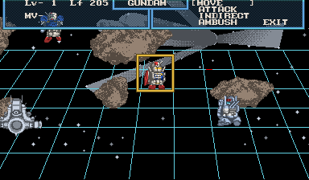

# Gundam reference color mod

This optional presentation mod colors the title, interface, opening tactical
scene, and identified allied mobile suits using original artwork. It changes
hue after native rendering. It does not replace sprites, rewrite game logic,
alter the camera, or add pixels. Japanese and English are both supported;
language and color are independent selections.

## References and artwork identity

| Artwork | Reference and authored treatment |
|---|---|
| Title | [Bandai's original game booklet](https://www.virtual-boy.com/games/sd-gundam-dimension-war/manuals/957156/), front: blue SD, gold Gundam lettering, silver subtitle |
| RX-78-2 Gundam | Booklet p4 and [official Bandai product art](https://www.bandai.com/gundam-infinity-rx-78-2-gundam): white armor, blue torso, red shield/feet, yellow accents |
| GP-01 Fb | [Bandai Spirits Full Burnern reference](https://tamashiiweb.com/item/13375/?wovn=en): white armor, blue upper chest/shoulder pods, yellow vents, green eyes, red feet |
| Rick Dias | [Bandai Spirits standard RMS-099 reference](https://tamashiiweb.com/item/14804/?wovn=en): gray/blue-gray armor, red forehead, teal mono-eye |
| Interface and environment | Authored white text, cyan grid, blue panels, gold selection, neutral steel and rocky terrain hues |

The standard Rick Dias scheme is an authoring choice; no named pilot establishes
the Quattro-specific red variant. At this resolution, body-part masks are an
interpretation of the reference art. Original four-level shading remains intact.

The native save records identify the opening allies without guessing from
silhouettes. Their descriptor pointers are `FFFE8630` (GUNDAM), `FFFF0644`
(GP-01 Fb), and `FFFEA0C0` (RICK-DIAS). In the original opening save they stand
at (8,11), (5,10), and (10,11). These are inspection evidence only: the runtime
color plugin never reads these descriptors, save data, or work RAM.

## Use

The build creates `dist/sd-gundam-color-0.1.0.vbmod`. Install it in the launcher's
Mods view and enable **Gundam reference colors**, or use:

```powershell
.\tools\play.ps1 -Language en -Color on
.\tools\play.ps1 -Color off
```

The current development executable is in `build/preview/` because the earlier
review executable remains open. Launch that build with an isolated profile:

```powershell
.\tools\play.ps1 `
  -Executable 'build/preview/SDGundamDimensionWarVirtualBoyRecomp.exe' `
  -Profile 'build/color-review-stereo' -Language en -Color on
```

`-Color saved` (the default) retains the profile's selection. Saves remain
under that profile's `saves/` directory. The preview profile is separate from
the original review game. See [save persistence](SAVES.md) for saving controls.

For a fresh prepared preview, `tools/preview_color.py` accepts a new profile
directory and optionally `--input-save` pointing to a private copy of the
validated three-area save. It loads Area 3 using ordinary controls, shows the
real SDL game window, releases debugger input, and leaves it running.

## Authoring

[colors/opening.json](../colors/opening.json) records reference links and
annotations against private source captures. `tools/capture_color.py` captures
the actual sampled CHR identities at draw time, independently for both eyes.
Some stereo sprites use different CHR artwork, so each eye has its own authored
masks. Opening a menu also changes world indices; those indices are used only
to label specific authoring captures.

`tools/author_color.py` compiles annotations into `mods/color/materials.txt`.
At runtime a lookup uses background map, sampling kind, source atlas cell,
CHR-content hash, and unflipped tile texel. Destination screen coordinates,
elapsed frames, and world indices are not runtime classification rules. Color
therefore follows the identified artwork through movement, flips, native
clipping, and stereo projection. Uniform materials can cover complete identified
tiles; anatomical detail masks retain individual texels.

The packaged metadata contains color IDs and source identities, not cartridge
graphics. Palette RGB values in `mods/color/palette.txt` are editable. Each hue
is normalized so its maximum channel equals the original native red intensity,
including brightness-register fades. Zero-intensity pixels remain black.
Conflicting uses of identical source art retain original red. The compiler
rejects annotations that match no source texels.

```powershell
python tools/author_color.py
python tools/build_color.py
```

Reauthoring requires the ignored captures named in the recipe. Ordinary builds
use the committed material metadata and need no authoring captures. Install a
rebuilt package into a fresh profile when iterating the same package version.

Reproduce the private capture inputs with `tools/capture_color.py`, supplying
`--framework`, `--exe`, and `--rom` as in the build instructions:

| Output directory (`--out`) | Route (`--route`) | English package |
|---|---|---|
| `validation/color-sources` | `tests/first-mission-route.json` | Disabled |
| `validation/color-sources-english` | `tests/save-create-route.json` | `--english-package dist/sd-gundam-english-0.1.0.vbmod` |
| `validation/color-free-map` | `tests/color-authoring-route.json` | Same English package |

Use new directories for independent captures; the recipe paths can be adjusted
to a new capture set. Shared profiles and owner save files are not required.

## Scope

This is the first color pass, covering the inspected opening route and save
menus. It is not a full-campaign asset audit: uncaptured poses, enemies, combat,
later missions, and endings can retain red. Unknown source art deliberately
falls back to the stock display. No widescreen changes are included.

The validation tools compare independent off/on executions across CPU, WRAM,
SRAM, VRAM, VIP, devices, raw left/right images, and audio. Every displayed pixel
must preserve its native maximum-channel intensity, which also proves exact
black/visible masks. Each identified opening ally must receive color in both
eyes. Separate checks cover persisted disabling, actual SDL presentation,
keyboard/pause/resume, and save loading/publication with English and color active.

## Validated result — 2026-09-12

| Check | Result |
|---|---|
| Final package off/on | [23 checkpoints through frame 9,250](color-validation.json), all nine guest/raw/audio planes identical; 138 byte audits |
| Native execution | 1,866,224,447 instructions per off/on process; zero interpreter/fallback instructions |
| Japanese + color | [10 opening checkpoints through frame 4,500](color-japanese-validation.json); all nine planes equal off/on, both-eye unit colors present, zero interpreter/fallback instructions |
| Presentation | Both eyes; exact native visible/black masks and maximum-channel intensities; all three allies receive color in each eye |
| Window and persistence | [English + color + Continue Area 3](color-window-save-validation.json): exact default-path load and clean-exit disk SRAM, real SDL presentation, keyboard, pause/resume all pass |
| Disable persisted color | [Stock red restored in both eyes](color-restoration-validation.json); English remains selected and its ROM asset hash remains exact |
| Runtime regression suite | CTest 6/6 passed |
| Translation authoring regression suite | 5/5 passed |
| Launcher/play helper | Both optional features appear independently in Mods; PowerShell explicit color/profile launch exits successfully |

Final color package SHA-256:
`fe1a77217703480e63965a434e53fd2370fdd6b98b8fc102f95f2df86cea1cbf`.
Runtime SHA-256:
`c1a16b86a93b90bb29c675a1c9f67a39f482735a75a2538a86feed2da9ec9e13`.
The color feature is game-local; framework commit
`44988f34b3bcc089985d9686717005401a96900b` is unchanged.

The final package contains 5,611 guarded material masks. One ambiguous 64-texel
source tile retains red; original black pixels remain black. Earlier private
iterations exposed empty authoring matches and missing right-eye sprite masks;
the compiler and semantic coverage checks now catch those cases. The persisted
disable check used an earlier material revision of the same plugin/package
version. The final off/on and window/save reports identify the final package hash.
Broader asset coverage is tracked as central issue `beads-vb.4.6`.

```powershell
python tools/validate_color.py `
  --framework '..\_wt-sd-gundam-vbrecomp' `
  --exe 'build/preview/SDGundamDimensionWarVirtualBoyRecomp.exe' `
  --rom 'roms/sd_gundam.vb' --route 'tests/save-create-route.json' `
  --english 'dist/sd-gundam-english-0.1.0.vbmod' `
  --color 'dist/sd-gundam-color-0.1.0.vbmod' `
  --out 'validation/color-new'
```





