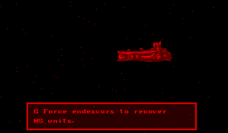

# English localization reference

Implemented after validation of the original Japanese game (Beads
`beads-vb.4.1` then `beads-vb.4.2`). Translation, color, and possible widescreen
are separate optional modifications; Japanese red presentation is the baseline.

The owner supplied `sdgundampatch.zip`, containing `sdgundampatch.ips` with no
readme or author attribution. The archive is kept in ignored `reference/`.
`tools/inspect_inputs.py` audits it without altering the cartridge on disk.

- Japanese ROM: 1,048,576 bytes, CRC32 `44788197`.
- ROM SHA-256: `98d210dcbd1c5d836aa5bbf018eb26e971711b69b4423187bbb72178d5da9a92`.
- IPS SHA-256: `4e3da3a54d520d9d14d5c98b4feeb5d39eca81587ee79b2c0ca48cfe61d45e67`.
- 35 records, 1,016 changed bytes, offsets `0x0f98e4` through `0x0f9d6f`.
- Applied in memory, the reference image hashes to
  `a143fb582956ce1f2214c0122a6cdd1f832bc82fb598c4d8a6b21102ccaab906`.

The patched independent Beetle reference completes the 19-checkpoint story
route through frame 2,200. At frame 2,000 the Japanese dialogue is replaced
by readable English ("G Force endeavors to recover MS units.") using the game's
own glyph rendering. No patch records lie outside the small range above.
This confirms the story surface; it does **not** establish whole-game language
coverage or provide new font assets.

Reproduce the private reference from tracked editable text, without requiring
the historical IPS archive:

```powershell
python tools/build_translation.py --framework vbrecomp --rom roms/sd_gundam.vb --check-reference --reference-out reference/sd_gundam_english.vb
```

Then capture `reference/sd_gundam_english.vb` with
`tools/capture_route.py --mode oracle`. The export checks the exact historical
reference hash and refuses to overwrite the original cartridge or a different
existing file. The compiled Japanese game continues
to require the original ROM. The patched reference is never an input to its
baseline build and remains ignored.

## Reference method

Use the sibling `snesrecomp/GundamWingEndlessDuelSNESRecomp` files:

- `docs/LOCALIZATION_PLAYBOOK.md`: asset interception, exact guards, language
  restoration, screen coverage, and visual validation pitfalls.
- `docs/TRANSLATION_TILEMAP_REFERENCE.md`: recover glyph mappings, editable
  string tables, row geometry, and strict generators.
- `scripts/analyze_reference_ips.py`, `scripts/decode_reference_tilemaps.py`,
  and `scripts/check_localization.py`: examples of the audit/generation loop.

Recover the VB asset format from this cartridge and live VIP state. Do not copy
SNES tile encodings or addresses. Classify every IPS span against reachable
code, text, tilemaps, and graphics. Capture the Japanese and reference-patched
surfaces through independent Beetle runs before implementing a runtime mod.

The game must draw its own translated assets. Use exact source-byte guards,
editable source strings/glyph maps, strict size/unsupported-glyph checks, and
reversible activation. Avoid framebuffer text overlays and pixel-based screen
detection. Runtime ROM data patches also need an audit for instruction bytes
and codegen-embedded constants, which cannot be changed by writing the live
ROM alone. Shared patch support belongs in vbrecomp; game assets and mappings
belong here.

## Editable native text

`translations/english.json` contains all 35 reference spans as editable strings,
their fixed byte capacities and padding rules, and an explicit glyph-to-native-
byte map. The map contains only glyphs observed in the supplied translation.
The existing font handles those characters; this patch adds no font art.
One span ends in NUL padding; the remaining spans use spaces. Native control
bytes between spans are preserved. Extending the character set requires
checking the game's actual glyph coverage first.

`tools/build_translation.py` validates the original ROM hash, rejects unknown
glyphs, oversized strings, overlapping spans, and any intersection with generated
instruction bytes. It generates an ignored C header containing exact original
guards and translated bytes, plus `dist/sd-gundam-english-0.1.0.vbmod`. Source
strings are included in the package for reference; the trusted implementation
is statically linked. Edit the JSON and rebuild to change the text. This is not
a runtime script loader. No ROM or generated cartridge C goes into the package.

The native emitter embeds instruction operands, while data loads go through
the runtime bus. The reference spans overlap zero of the 137,371 unique
generated instruction entries audited in this build. This makes them suitable
for guarded data changes without changing the Japanese generated code.

Check exact reference reproduction with:

```powershell
python tools/build_translation.py --framework '..\_wt-sd-gundam-vbrecomp' --check-reference
python -m unittest discover -s tests -p 'test_*.py'
```

The original 35 entries reproduce the patched-image SHA-256 above, including
all padding, with exactly 1,016 changed bytes. The five authoring tests cover
padding, unsupported glyphs, size limits, control-code mappings, and overlap.

## Runtime integration

`src/translation_mod.cpp` registers the optional `sd-gundam.reference-english`
plugin. It selects the framework's exclusive `rom.assets` plan during activation.
Since activation precedes loading, the plan stays pending until the host verifies
the original cartridge and loaded CRC, then applies it before the first guest
instruction. No const cast or disk patch is used.

Every span must match its exact source or translated payload before any span is
written. A failed guard rejects the entire plan. The reset callback restores
Japanese when disabled; already-uploaded assets refresh when the game reloads
them, so restart to replay all text in the new language. The framework's six
CTest checks include atomic guards, restoration, reload, overlap, and bounds.

Install the package in the launcher's Mods view and enable **English story text**,
or use `.\tools\play.ps1 -Language en`. Use `-Language ja` to disable it and
start the original language. No language argument preserves the saved selection.

`tools/validate_translation.py` launches native-only execution on the original
ROM with the package enabled, and a separate Beetle process on the privately
patched reference. It verifies the entire live ROM image at frame zero, then
compares all ten state/output planes. `--restore-from <prior runtime directory>`
copies the enabled private test profile and disables English before comparing
against the Japanese oracle. It also verifies the original file stayed unchanged.

The package reproduces the supplied reference translation. It does not claim
that every campaign screen is translated or that all 35 lines have been reached
visually; broader editorial and gameplay coverage remains separate work.

## Validated result

On 2026-09-12, English enabled and Japanese restored each passed all 40
checkpoints through frame 4,500 against their corresponding independent Beetle
ROMs, across all ten planes with 280 byte audits each. Neither run used the
interpreter or fallback. English executed 918,551,955 native instructions;
Japanese executed 914,443,855. The full in-memory cartridge hashes matched the
respective reference images, and the original disk file stayed unchanged.

The runtime was `3823aed9e383b7a3316e428ec318ae9ff7ca606c502f9c2971f9a49685181cc8`,
using framework `44988f34b3bcc089985d9686717005401a96900b`. Machine-readable
results: [English](english-validation.json), [restored Japanese](japanese-restoration.json).
The installed/enabled launcher toggle and the native English story were inspected.
A patched cartridge supplied directly to the host was correctly rejected.


