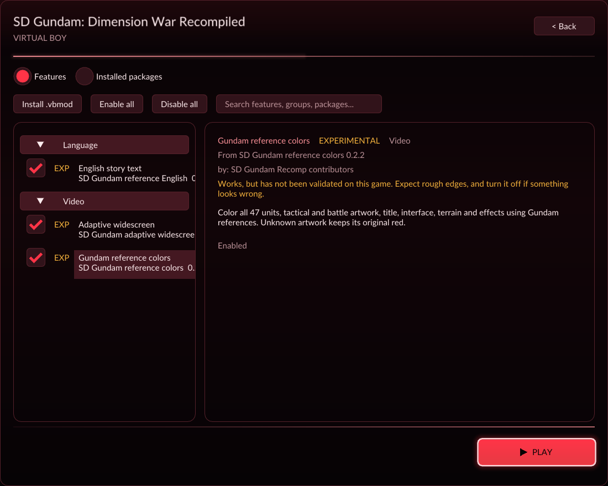
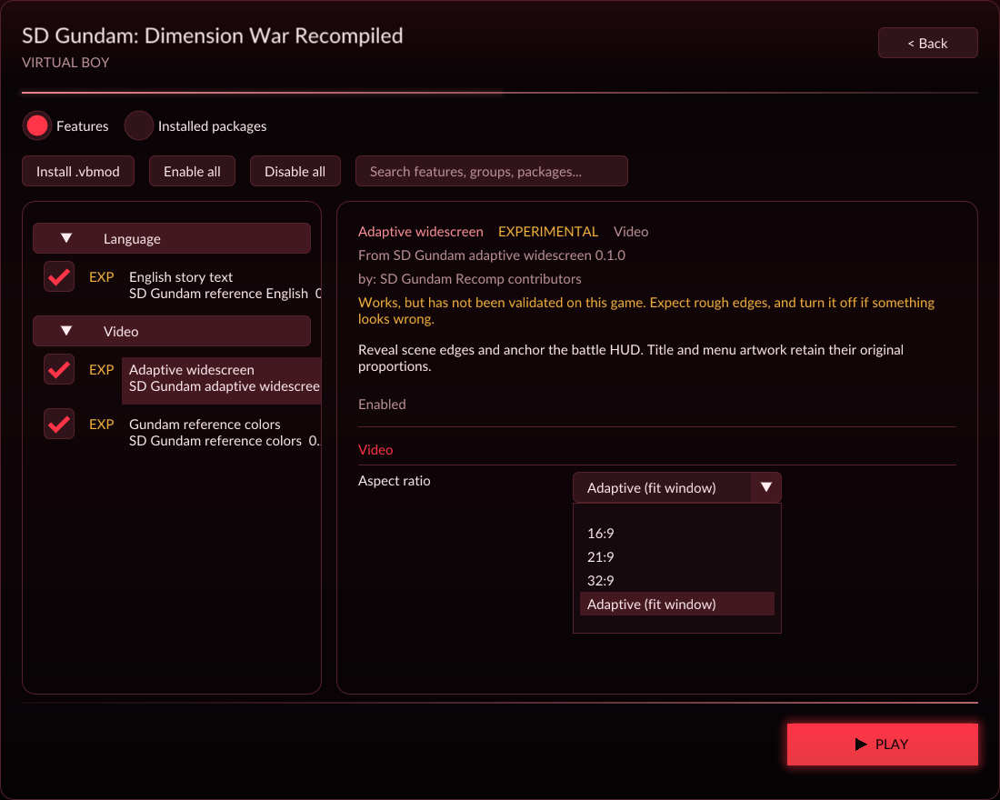

# Early prototype publication

This is an **early prototype; bugs are expected**. The opening and selected
combat/save routes have substantial validation, but later missions, endings
and every possible mod combination have not received a full playthrough.

The repository follows Zero Racers with pinned `vbrecomp` and `recomp-ui`
submodules, game-specific source and cartridge configuration, build helpers,
editable mod sources, launcher artwork/notice, and recorded validation.
The normal UI-enabled build creates these independent, default-off packages:

| Mod | Version | Source |
|---|---|---|
| English story text | 0.1.0 | `mods/english`, `translations/english.json` |
| Gundam reference colors | 0.2.2 | `mods/color`, `colors/` |
| Adaptive widescreen | 0.1.0 | `mods/widescreen` |

Widescreen offers 16:9, 21:9, 32:9 and fit-to-window. The original Japanese ROM
is required. Generated code and build/package outputs stay ignored; no ROM,
reference patch archive, save file or private source capture is distributed.

## Clean-checkout verification

[Publication validation](publication-validation.json) records the exact inputs,
binary/package hashes and successful checks. A new clone fetched both pinned
dependencies from public GitHub remotes and regenerated all 3,180 functions and
137,395 instructions. Generated guest code and the guarded English header match
the validated development baseline byte-for-byte.

The first clean build exposed a missing dependency between the root English
generator and the framework's runtime target. An explicit package target now
generates the header before compilation. The build was repeated with that
header absent, and successfully produced the executable and all three mods.
The English archive is deterministic and still reproduces the reference
translated-ROM hash without changing generated instructions.

All six runtime tests and nine authoring tests pass. The framework Python suite
runs 85 tests: 80 pass and five optional tests skip. A real launcher check shows
the title thumbnail, settings/controller pages, all three mods and four aspect
choices. Independent native processes agree across nine guest/raw/audio planes
through load and resumed gameplay; both-eye native replay and expanded colors
match their source data, with zero fallback/interpreter instructions.

The fresh executable also passes five live window shapes, keyboard/pause input,
and exact SRAM publication. Five process starts verify default-off, enabled,
persisted, disabled and persisted-off widescreen behavior without changing the
validated battery save or losing English/color selections.

History and tracked-file audits found no credential signatures or private game
artifacts. Ignore checks cover ROMs, generated sources, patch archives, saves,
captures, credentials and analysis databases. Dependency pin files match the
Git submodule entries. Older validation records retain their original binary
and package hashes; this report identifies the fresh publication build.

Owner-supplied [color screenshots and comparison](../README.md#screenshots)
are actual captures with pixel-preserving crops, not generated illustrations.
Central issue: `beads-vb.4.8`.
