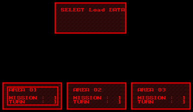
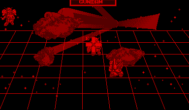

# Battery saves

SD Gundam has three in-game save areas. The shared host persists its 64 KiB
cartridge RAM to a battery-save file. Japanese and English use the same game
identity and save path; language selection does not create a separate save set.

## Save and continue

On the tactical map, press **Select** (keyboard **Right Shift**) to open the
system menu, choose **SAVE GAME**, select a save area, and confirm with **A**
(keyboard **X**). **B** (**Z**) cancels or returns to area selection. At the
title screen, choose **CONTINUE**, select an occupied area, and confirm.
These are the cartridge's own menus and serialization routines. See the
[original instruction booklet, page 17](https://www.virtual-boy.com/games/sd-gundam-dimension-war/manuals/957156/).

For the normal launcher/window build, the default file is:

```text
<directory containing vbrecomp.cfg>/saves/sd-gundam-dimension-war.sav
```

In this development checkout, that is normally
`build/vbrecomp/runtime/saves/sd-gundam-dimension-war.sav`. A custom `--config`
path moves the default save root alongside that configuration. `--save PATH`
selects an explicit file. Headless runs need `--save` to enable persistence;
the ordinary comparison tools intentionally use `--no-save`.

The game writes battery RAM when saving. The host reads the file before the
first guest instruction and publishes the current 64 KiB RAM image on normal
window close or debugger Quit. It writes a temporary file and atomically
replaces the previous file. Escape opens settings; it does not exit the game.
This is normal shutdown/restart persistence, not crash recovery or a savestate
system. Copy the `.sav` file while the game is closed to back it up or move it
to another checkout. A truncated file is rejected rather than silently reset.

## Reproducible validation

`tools/validate_saves.py` uses separate private profiles and normal pad input
to create two saves, move the Gundam one grid position, and preserve both slots.
It restarts in Japanese from the English-created save, loads the moved unit,
saves to the third area, then restarts in English and loads that area. The
normal window path and an actual window-close event are tested separately.
Truncated-input and failed-write cases must preserve the prior files.

Every labelled gameplay checkpoint compares CPU, WRAM, SRAM, VRAM, VIP,
devices, both eye images, presentation, and audio against independent Beetle.
The oracle frontend imports the same battery-file input at frame zero using
its SRAM debug interface; CPU/work-memory/video state is never synchronized.
All native runs require zero interpreter fallback. The live SRAM image must
equal the file written after closing each process.

```powershell
python tools/validate_saves.py `
  --framework '..\_wt-sd-gundam-vbrecomp' `
  --exe 'build/vbrecomp/runtime/SDGundamDimensionWarVirtualBoyRecomp.exe' `
  --oracle 'build/vbrecomp/runtime/vb-beetle.exe' `
  --rom 'roms/sd_gundam.vb' --reference-rom 'reference/sd_gundam_english.vb' `
  --package 'dist/sd-gundam-english-0.1.0.vbmod' `
  --out 'validation/save-persistence-new'
```

Use a native Windows Python and a new output directory. The translated oracle
input is prepared with `tools/inspect_inputs.py --write-reference-rom`.
Private save files and complete captures remain under ignored `validation/`.

The inspected cartridge format places areas at offsets `0`, `0x5d0`, and
`0xba0`, each with three `0x1f0` copies. Each copy includes the native
`VB-GUNDAMSAVEDATA00/01/02` identifier on even byte addresses. The harness
checks all copies and the observed moved-unit coordinates. It does not edit
the game's payload or manufacture checksums.

## Validated result — 2026-09-12

[Machine-readable report](save-validation.json): **passed**. The existing
framework persistence implementation required no changes. Framework commit
`44988f34b3bcc089985d9686717005401a96900b` was used; the runtime also includes
the pending presentation source-tracking constructor (no active color renderer).
Exact runtime, oracle, cartridge, and English-package hashes are in the report.

| Check | Result |
|---|---|
| English game-created Areas 1 and 2 | 14 checkpoints through frame 9,250; Gundam moves from (8,11) to (9,11); Area 1 preserved |
| Japanese Continue and Area 3 save | 5 checkpoints through frame 5,340; loaded position preserved in every copy; Areas 1 and 2 unchanged |
| English Continue from Japanese Area 3 | 4 checkpoints through frame 3,500; resumed mission matches independent oracle |
| Native execution | 3,635,240,319 instructions; zero interpreted or fallback instructions |
| Independent comparison | 23 checkpoints across all ten planes; 161 byte audits; no divergence |
| Disk persistence | Exact 65,536-byte SRAM image after each clean exit; exact input before each fresh boot |
| Default window path | Existing save loaded; real SDL window close exits 0 and atomically republishes it |
| Invalid input / failed write | Exit 6; truncated input and prior valid save remain unchanged |

Final three-area save SHA-256:
`ed5b9320f41b46904bad5296854c5ccccb2a8a693d4e9d1479ed4fc850091a44`.
Private evidence: `validation/save-persistence-02/`. Tests use isolated profiles;
the owner's open game and save file were not accessed. This validates opening
mission progress, not campaign completion or interruption during a power loss.




