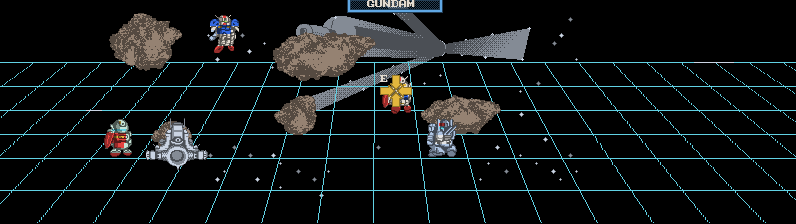
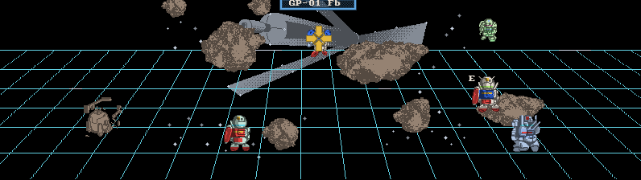

# Adaptive widescreen mod

Install `dist/sd-gundam-widescreen-0.1.0.vbmod`, enable **Adaptive widescreen**
in Mods, and select **Aspect ratio** in its detail panel. It is off by default
and works independently of English and color. Rebuild the game with the pinned
framework before installing this package.

```powershell
.\tools\play.ps1 -Language en -Color on -Widescreen adaptive
.\tools\play.ps1 -Widescreen '16:9'
.\tools\play.ps1 -Widescreen '21:9'
.\tools\play.ps1 -Widescreen '32:9'
.\tools\play.ps1 -Widescreen off
```

Omitting `-Widescreen` preserves the profile's selection. The launcher saves
both enablement and aspect. Adaptive follows the window when resized or
maximized; fixed modes retain their selected ratio and letterbox the window.
The initial window uses the normal host size, so resize it to see a wider
adaptive view. English and color remain selected when widescreen is disabled.

| Selection | Gameplay pixels per eye |
|---|---|
| Original | 384x224 |
| 16:9 | 398x224 |
| 21:9 | 522x224 |
| 32:9 | 796x224 |
| Adaptive | Nearest even width at height 224, from the window's aspect |

Widths round to even pixels to keep the original image centered without
stretching individual sprites. The original Virtual Boy aspect is already
close to 16:9, so its expansion is small. Narrow and portrait windows keep the
full native image. Adaptive caps at 2048 pixels per eye for very wide windows.
With `--stereo`, the two eyes remain stacked and aspect uses each eye's height.

## What expands

The tactical map reveals terrain submitted beyond the screen edges, continues
the native perspective grid, and recovers live units omitted by the original
horizontal projection limits. Battle scenes use a wider viewport, place the two HUD panels
at the edges, and distribute the original star objects across the wider view.
Timers, prompts and suit geometry retain their native size. Native left/right
parallax, brightness, fades, source artwork and optional color masks survive
the presentation pass.

Title, story and save-menu artwork stays at its original extent. The tactical
colony panorama is a finite drawing, so wide margins can contain empty space.
Live units use their original artwork and the native depth/height projection;
there are no invented units. Terrain absent from submitted VIP worlds remains
outside this implementation. It does not expand map
movement, change combat timing or create replacement scenery. Later missions
and endings remain outside the validated playthrough; unrecognized scenes
automatically retain their original extent.

## Implementation and reference

`src/widescreen_mod.cpp` supplies title-specific recognition and layout policy
to the framework's read-only VIP snapshot renderer. Tactical recognition uses
the native map-4 panorama plus map-2 affine terrain descriptors. Battles use
map-4/map-6 affine sheets and the native full-screen map-0 HUD. The top 32 HUD
rows have separate left/center/right anchors. Four observed star tile content
hashes identify stars independently of reused CHR slots; no stars are added.

`src/widescreen_scene.cpp` observes the original OAM transfer at guest PC
`FFF04586` without replacing its function. It latches WRAM unit records,
occupancy and camera metadata alongside each VIP snapshot. Valid occupied
units omitted by zero/out-of-range columns in ROM projection table `DD5C8`
use an extension of that row's native horizontal pitch. Original height,
depth, stereo parallax, cell maps and CHR banks remain in use. The recovered
sprites are placed after their corresponding depth world so nearer layers
retain occlusion. Width 384 bypasses these additions entirely.

The grid's outside mapping derives horizontal lines and diagonal spacing from
the submitted native grid map, then samples the existing source pixels beyond
the old world bounds. Native center pixels keep their original mapping.

The reference was `../psxrecomp/BattleArenaToshindenRecomp`, particularly
`src/mods/toshinden_widescreen_plugin.c`,
`src/mods/toshinden_widescreen_backdrop.c` and its widescreen package README.
The useful shared pattern is title-specific scene classification, anchored HUD,
and proportion-preserving menus. Virtual Boy uses a separate VIP presentation
replay; Toshinden's PSX projection and packet logic do not apply directly.

The native VIP rasterizer and generated guest code are unchanged. Inputs are
captured at each eight-row drawing block, tied to the displayed framebuffer,
then replayed at the selected width. The color callback consumes the resulting
source provenance at that width. No guest ROM, memory, save or timing mutations
are part of the mod. See the framework's `docs/VIEWPORT.md` for its contract,
snapshot ownership and direct-CPU-framebuffer limitation.

## Reproduce the checks

Keep a built copy of the committed color baseline (`c21b10c`, framework
`44988f34`) and pass it as `--baseline`. Use separate output directories.

```powershell
python tools/validate_widescreen.py `
  --framework '..\_wt-sd-gundam-vbrecomp' `
  --exe 'build/widescreen/SDGundamDimensionWarVirtualBoyRecomp.exe' `
  --baseline 'build/campaign/SDGundamDimensionWarVirtualBoyRecomp.exe' `
  --route 'tests/widescreen-route.json' --aspect '32:9' `
  --out 'validation/widescreen-new'
```

The validator checks nine guest/raw/audio planes across two independent native
processes. At every checkpoint, both-eye snapshot replay at 384 pixels must
match the original raster exactly. Every visible wide texel must retain its
brightness and, with color enabled, match its assigned material. Additional
tools validate real SDL resizing/pause/input, launcher options, and saved
enablement/aspect plus battery SRAM across restarts. Reports below record the
tested routes and binaries; this is an experimental presentation mod, not a
complete campaign validation.

Pinned framework: `14a96341753f6fe4a7a81ec0939953d35abb6d99`.
Central issues: `beads-vb.4.4` (game), `beads-vb.1.6` (shared renderer).

## Recorded results

[Validation manifest](widescreen-validation.json) records binary/package hashes
and route results. The final runtime passes 25 checkpoints through frame 34,790,
with all nine native planes equal to the committed baseline and zero fallback
or interpreter instructions. Both-eye replay at 384 matches the original
raster at every checkpoint. Final stacked-stereo window checks cover five
window shapes, pause/input and exact battery publication; five process starts
verify default-off, enabled, persisted, disabled and persisted-off behavior.

[Unit recovery proof](widescreen-unit-validation.json) checks three camera
positions. Projection reproduces visible units' native OAM tiles, and every
visible recovered GM, Salamis, Rick Dias and Zaku texel matches original CHR
hash, UV and raw level in both eyes. Separate runs cover 16:9, Japanese 21:9
without color, and 32:9. The final color 0.2.2 package also passes load/menu
and resumed-game composition at 32:9; the long run used color 0.2.1 before the
shared-panel metadata correction. Exact tested versions are retained in reports.




